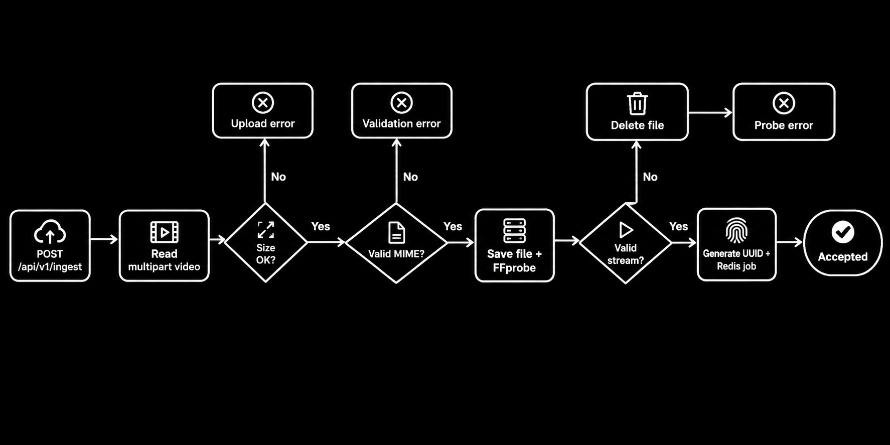
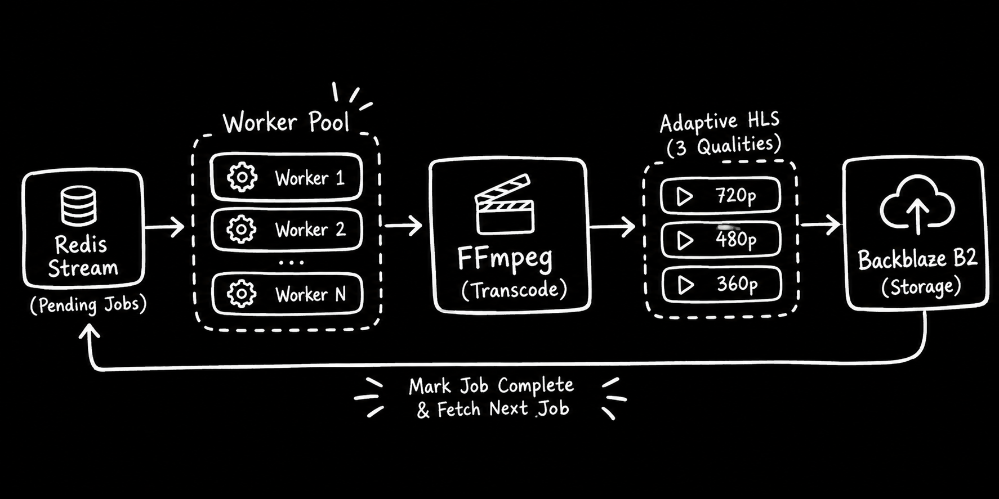
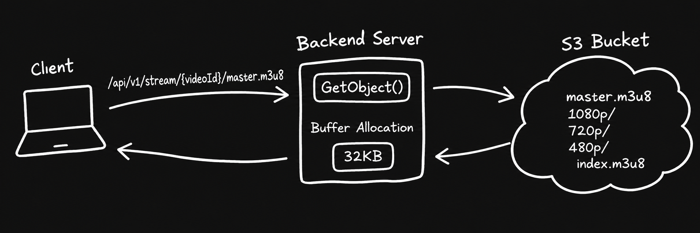

# Prism

**A high-performance, low-memory video transcoding and adaptive HLS streaming engine written in Go.**

Prism is a video-processing backend that accepts video uploads, queues transcoding jobs, generates multiple HLS renditions with FFmpeg, stores the resulting playlists and segments in an S3 compatible bucket, and serves those assets through an HTTP streaming endpoint.

The API and transcoding worker run as separate processes. Redis Streams decouples uploads from CPU-intensive video processing, while a configurable worker semaphore limits the number of jobs processed concurrently.

## Features

- **Asynchronous video ingestion** — accept uploads without making the API wait for transcoding to finish.
- **Upload validation** — enforce a configurable request-size limit, check supported video MIME types, and inspect video metadata with `ffprobe`.
- **Redis Streams job queue** — publish jobs and consume them through a Redis consumer group.
- **Bounded worker concurrency** — configure the maximum number of concurrently processed jobs.
- **Adaptive HLS output** — generate 1080p, 720p and 480p H.264 renditions with AAC audio when an audio track is present.
- **Object storage** — upload generated playlists and segments to Backblaze B2 through its S3-compatible API.
- **HTTP HLS delivery** — retrieve playlists and segments from object storage with suitable content types and cache headers.
- **Temporary-file cleanup** — remove local input and output files after a successful upload to object storage.

## Architecture

### 1. Video ingestion

The ingestion endpoint receives a multipart upload using the `video` form field. Prism applies the configured request-body limit, checks the detected MIME type, writes the file to local disk, and runs `ffprobe` to confirm that a video stream exists and has valid dimensions.

A UUID is generated for each accepted upload. The API then publishes a job containing the video ID, input path and output directory to Redis Streams.



<br>

---

### 2. Transcoding and worker pipeline

The worker process reads jobs from a Redis Stream consumer group. A semaphore limits the number of jobs being processed at the same time.

For each job, Prism checks whether the input contains an audio track and invokes FFmpeg to generate three HLS renditions:

| Variant | Target resolution | Video bitrate |
|---|---:|---:|
| 1080p | 1920 × 1080 | 5000 kbps |
| 720p | 1280 × 720 | 2800 kbps |
| 480p | 854 × 480 | 1400 kbps |

The configured FFmpeg pipeline uses H.264 (`libx264`), the `veryfast` preset, AAC audio when available, four-second HLS segments, and a VOD playlist. It creates a master playlist and a variant playlist for each rendition.



**Concurrency and resource usage**

`SEMAPHORE_SIZE` controls how many jobs a worker process can execute concurrently. This provides a straightforward way to limit simultaneous FFmpeg processes and the associated CPU and memory pressure.

<br>

---

### 3. HLS storage and delivery

After transcoding, the worker uploads the generated directory to Backblaze B2. Assets are stored under the following object-key layout:

```text
videos/
└── <video-id>/
    ├── master.m3u8
    ├── 1080p/
    │   ├── index.m3u8
    │   └── segment_000.ts
    ├── 720p/
    │   ├── index.m3u8
    │   └── segment_000.ts
    └── 480p/
        ├── index.m3u8
        └── segment_000.ts
```

The exact number of segments depends on the source video's duration. The master playlist references the available quality variants, allowing an HLS-compatible player to select a rendition based on playback conditions.

The API exposes an endpoint that fetches the requested object from B2 and streams its response to the client.



**Caching behavior**

- `.m3u8` playlists: `no-cache, no-store, must-revalidate`
- Media segments: `public, max-age=31536000, immutable`

<br>

---

## Technology stack

- Go
- Redis
- FFmpeg
- FFprobe

## Requirements

- Go version matching the module declaration (`go 1.27.1`).
- FFmpeg and FFprobe installed and available on `PATH`.
- A reachable Redis instance.
- A Backblaze B2 bucket and S3-compatible application credentials.

<br>

## Getting started

### 1. Clone the repository

```bash
git clone https://github.com/Habeebamoo/Prism.git
cd Prism
```

### 2. Configure the environment

Create the `.env` file using the variables above.

### 3. Start Redis

Run Redis locally or provide the URL of an existing Redis instance.

```bash
redis-server
```

### 4. Install dependencies

```bash
go mod download
```

Ensure `ffmpeg` and `ffprobe` are installed:

```bash
ffmpeg -version
ffprobe -version
```

### 5. Start the API

In one terminal:

```bash
go run ./cmd/api
```

The API listens on the port configured by `PORT`.

### 6. Start a worker

In another terminal:

```bash
go run ./cmd/worker
```

You can run additional worker processes to increase processing capacity. Set `SEMAPHORE_SIZE` according to the resources available to each worker instance.

### 7. Upload a video

```bash
curl -X POST http://localhost:8080/api/v1/ingest \
  -F "video=@./sample.mp4"
```

Once processing and upload complete, request the master playlist using the corresponding video ID:

```text
http://localhost:8080/api/v1/stream/<video-id>/master.m3u8
```
